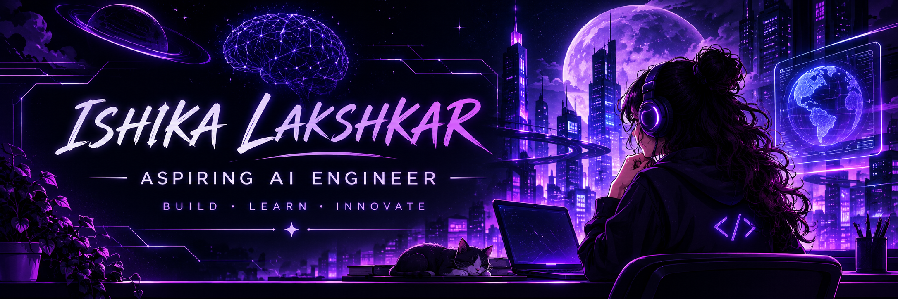

<!-- CYBERPUNK PROFILE — upload the banner to assets/cyberpunk-banner.png -->

<p align="center">
  
</p>

<h1 align="center">ISHIKA LAKSHKAR</h1>
<h3 align="center">⚡ ASPIRING AI ENGINEER · GENERATIVE AI · MACHINE LEARNING ⚡</h3>

<p align="center">
  
</p>

<p align="center">
  <a href="https://www.linkedin.com/in/ishika-lakshkar-a54bba3a1/"></a>
  <a href="https://github.com/ishika357"></a>
</p>

---

## ◈ SYSTEM PROFILE

> **Curious mind. Builder mindset. Focused on practical AI.**

I'm a final-year B.Tech Computer Science and Engineering student specializing in Artificial Intelligence. I'm learning to design and build useful AI-powered applications, with a growing focus on Generative AI, language models, and intelligent workflows.

- 🧠 Exploring **AI, Machine Learning, NLP, and LLM applications**
- 🛠️ Learning by building, testing, debugging, and improving projects
- 🔭 Interested in **RAG, AI agents, and practical AI engineering**
- 🌌 Goal: turn concepts into reliable, real-world applications

## ◈ TECH STACK

<p align="center">
  
</p>
<p align="center">
  
  
  
  
  
</p>

## ◈ FEATURED BUILD — INTERVIEWIQ

<p align="center">
  <a href="https://github.com/ishika357/interviewiq">
    
  </a>
</p>

### 🎙️ InterviewIQ — AI Interview Intelligence Platform

**Practice with purpose. Get evidence-based feedback. Improve with a plan.**

InterviewIQ is a Flask-based mock interview platform that helps candidates practise, evaluate their answers, and identify what to improve next.

| MODULE | WHAT IT DOES |
|:--|:--|
| ⚡ Adaptive interviews | Selects follow-up questions and adjusts difficulty |
| 🧠 Explainable evaluation | Breaks feedback into technical accuracy, relevance, quality, and communication |
| 🎧 Voice workflow | Transcribes recorded answers and extracts delivery metrics |
| 🔎 RAG knowledge assistant | Retrieves relevant knowledge for source-aware explanations |
| 📄 Resume-aware setup | Uses skills, projects, and education from an uploaded PDF to tailor interview context |
| 💻 Coding assessments | Runs coding problems against visible and hidden tests |
| 🗺️ Learning roadmap | Creates a personalized 7-day practice plan from detected strengths and gaps |

<p align="center">
  <a href="https://github.com/ishika357/interviewiq"></a>
</p>

<details>
  <summary><b>◈ Peek at the architecture</b></summary>

  ```mermaid
  flowchart TD
      A[Browser UI] --> B[Flask API]
      B --> C[Interview Orchestrator]
      C --> D[Adaptive Interviewer]
      C --> E[Answer Evaluator]
      C --> F[Speech Analytics]
      C --> G[Resume Parser]
      C --> H[Coding Assessment]
      C --> I[RAG Assistant]
      C --> J[Learning Roadmap]
      D --> K[(SQLite)]
      E --> K
      F --> K
      I --> L[Knowledge Base]
  ```

  Explore the [full project documentation](https://github.com/ishika357/interviewiq), including architecture, setup, tests, and engineering decisions.
</details>

## ◈ CURRENTLY EXPLORING

<p align="center">
  
  
  
  
</p>

## ◈ GITHUB SIGNAL

<p align="center">
  
  
</p>
<p align="center">
  
</p>
<p align="center">
  
</p>

---

<p align="center">
  <b>CODE. CREATE. CONTRIBUTE.</b><br/>
  <sub>Learning • Building • Evolving ✦</sub>
</p>
